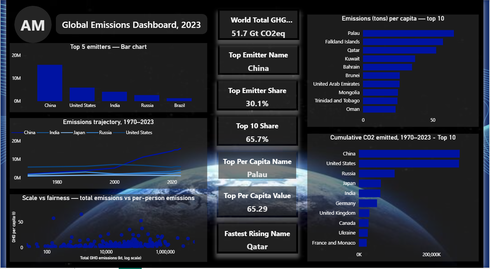

# 🌍 Global GHG Emissions Dashboard

_Who emits the most, who is climbing, who is historically responsible, and who the headlines miss, using Python (web scraping + pandas), DAX, and Power BI._

---
## Overview

This project takes public greenhouse gas (GHG) and CO2 emissions tables from Wikipedia and turns them into an interactive Power BI dashboard. The workflow covers the full analytics lifecycle: web scraping, data cleaning and merging, data modeling, DAX measure design, and dashboard storytelling.



---
## Business Problem

Raw emissions tables answer one question: who emits the most. They don't show who is accelerating, who is historically responsible, or whether population size is hiding the real story. This project aims to:
- Show current emitters, long-term trends, and cumulative responsibility side by side
- Separate **scale** (total emissions) from **fairness** (per-person emissions)
- Surface small countries with extreme per-capita emissions that rarely make headlines
- Give decision-makers headline KPIs they can read in seconds

---
## Dataset

- Source: two Wikipedia pages, *Greenhouse gas emissions* and *CO2 emissions by country*, scraped with Python
- Cleaned, merged dataset: `data/climate_dashboard_data.csv`
- Time series, 1970-2023: `data/emissions_trend.csv`
- Fields include country, total GHG emissions, CO2 emissions, per-capita emissions, and share of global total

---
## Tools & Technologies

- **Language:** Python
- **Scraping & Data Handling:** Requests, Pandas, Google Colab
- **Visualization & Modeling:** Power BI
- **Measures:** DAX
- **Version Control:** Git & GitHub

---
## Skills Demonstrated

- Web Scraping (HTML tables to DataFrames)
- Data Inspection & Cleaning
- Data Merging & Validation
- Data Modeling in Power BI
- DAX Measure Design (TOPN, CALCULATE)
- Dashboard Design & Data Storytelling
- Data Formatting for Readability

---
## Project Structure

```
climate-change-dashboard/
│
├── README.md
│
├── dashboard/
│   └── climate_change_dashboard.pbix
│
├── data/
│   ├── climate_dashboard_data.csv
│   └── emissions_trend.csv
│
├── notebooks/
│   └── climate_scrape.ipynb
│
└── docs/
    ├── dashboard.png
    ├── DAX.txt
    └── features.txt
```

---
## Project Workflow

1. Scrape the two Wikipedia pages with Requests + Pandas
2. Identify the usable data tables (most "tables" on each page are navigation elements)
3. Merge the GHG and CO2 tables on country name
4. Clean and validate (nulls, duplicates, inconsistent labels)
5. Recalculate global share percentages against the correct total
6. Load into Power BI and fix data types
7. Write DAX measures for each KPI card
8. Design five visuals, each answering a different question

---
## Data Cleaning

Most of the effort went into cleaning, not charting:
- The merge was silently dropping rows because **"GLOBAL TOTAL" and "Global Total"** were treated as two different countries
- Nulls and duplicates were checked before trusting any number
- Global share percentages were recalculated so they were based on the right total, not inherited from the wrong table
- In Power BI, percentages stored as text and numbers read as categories were converted to the correct data types

---
## DAX Measures

Every KPI card is a DAX measure. None is a plain sum; each uses `TOPN` / `CALCULATE` to return an exact ranked value. Full definitions are in [`docs/DAX.txt`](docs/DAX.txt).

| KPI Card | What it shows |
|---|---|
| World Total GHG | Global total, formatted as **51.7 Gt CO2eq** instead of a raw 51,720,000 |
| Top Emitter Name | Highest-emitting country (**China**) |
| Top Emitter Share | Its share of the world total (**30.1%**) |
| Top 10 Share | Combined share of the ten largest emitters (**65.7%**) |
| Top Per Capita Name | Country with the highest per-person emissions (**Palau**) |
| Top Per Capita Value | Its emissions per person (**65.29 t**) |
| Fastest Rising Name | Fastest-rising emitter (**Qatar**); exact calculation in `docs/DAX.txt` |

---
## Dashboard

Five visuals, each answering a different question:

| Visual | Question it answers |
|---|---|
| **Top 5 emitters** (bar) | Who emits the most today? |
| **Emissions trajectory, 1970-2023** (line) | Who is climbing, who is flattening? |
| **Scale vs fairness** (scatter, log scale) | How do total emissions compare with per-person emissions? |
| **Cumulative CO2, 1970-2023** (bar, top 10) | Who is historically responsible, not just currently? |
| **Emissions per capita** (bar, top 10) | Which small countries are outliers the headlines miss? |

---
## Key Insights

- China emits about **30.1%** of global GHG, and the **top 10 emitters account for 65.7%**
- On cumulative CO2 since 1970, **China and the United States are close to each other**, well ahead of Russia, Japan and India
- Per-capita rankings are led by small territories (**Palau, Falkland Islands, Qatar, Kuwait, Bahrain**), a very different list from the top total emitters
- Total emissions and per-person emissions tell different stories, which is why the scatter plot exists

---
## Data Sources & Limitations

- Data comes from Wikipedia, a **secondary source** that compiles figures from other datasets. This is a learning and portfolio project, not an authoritative analysis. For formal work, use primary sources such as EDGAR, Climate Watch, the Global Carbon Project or Our World in Data.
- Per-capita leaders are very small-population territories, so they are statistical outliers rather than major emitters.
- GHG (CO2eq) and CO2-only figures measure different things and are shown on separate visuals.

---
## How to Run This Project

1. Clone the repository:
```bash
git clone https://github.com/TufanAnalyst/climate-change-dashboard.git
```
2. Open `notebooks/climate_scrape.ipynb` in Google Colab or Jupyter and run all cells (requires `requests`, `pandas`, `lxml`)
3. Open `dashboard/climate_change_dashboard.pbix` in Power BI Desktop. If the data source path breaks, go to *Transform data > Data source settings* and point it to the CSVs in `data/`.

---
## Future Work

- Rebuild the dataset from primary sources (EDGAR, Climate Watch, Global Carbon Project)
- Add population and GDP data to explore emissions intensity
- Add year and region slicers for interactive filtering
- Publish the report to Power BI Service for a live, shareable demo

---
## Author & Contact

**Ahmad Munir**
📧 Email: ahmad.munir.data@gmail.com
🔗 [GitHub](https://github.com/TufanAnalyst)
🔗 [LinkedIn](https://www.linkedin.com/in/ahmad-munir-437430376)
